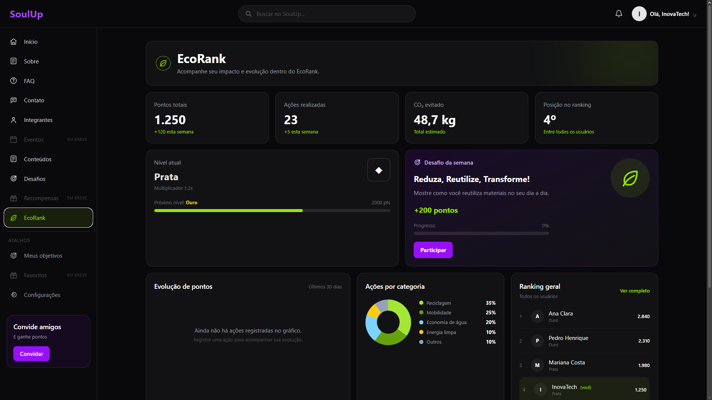
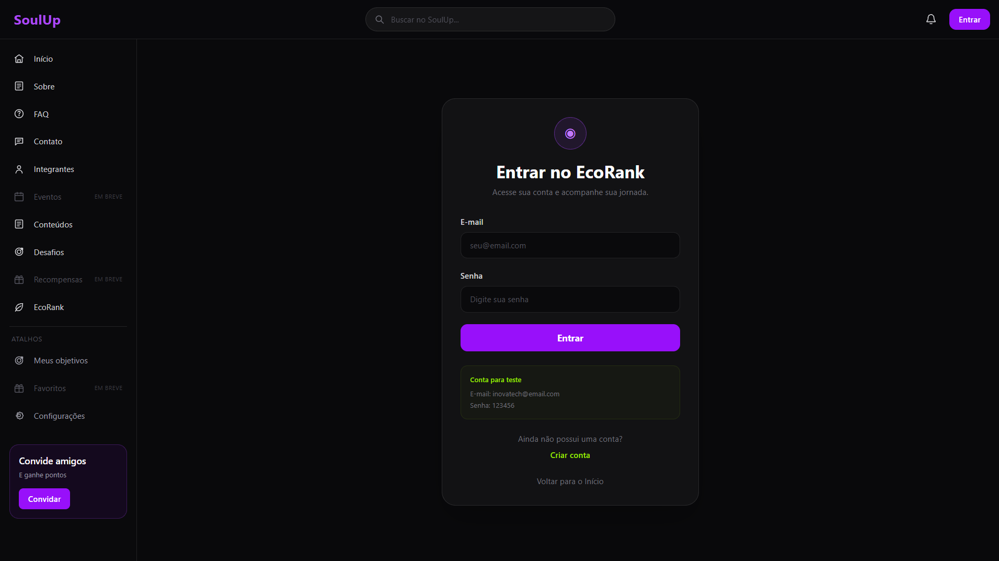
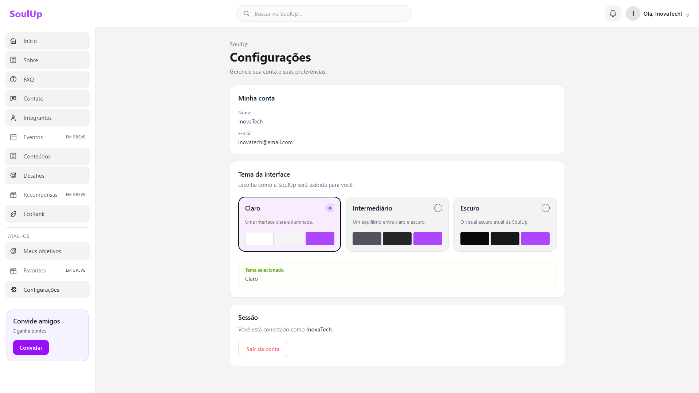
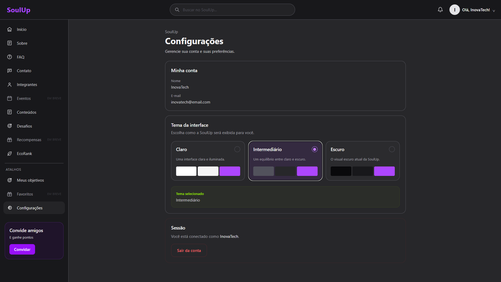
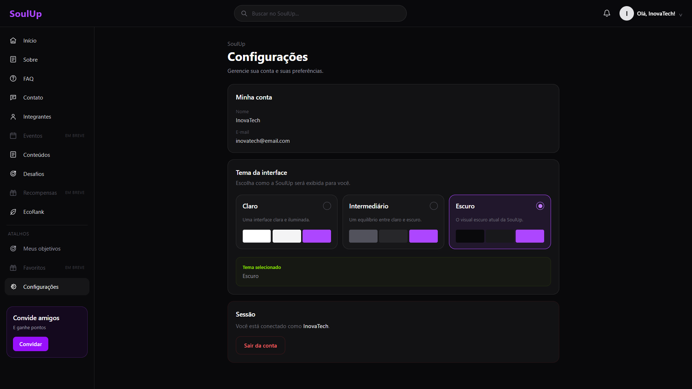
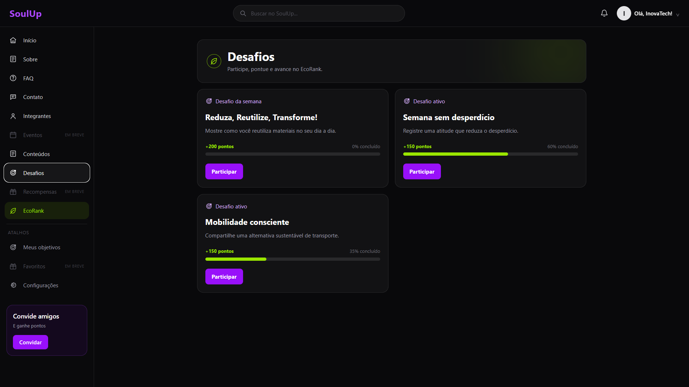
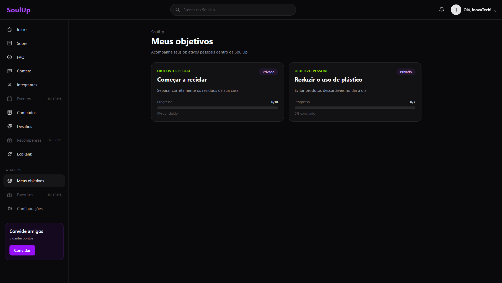
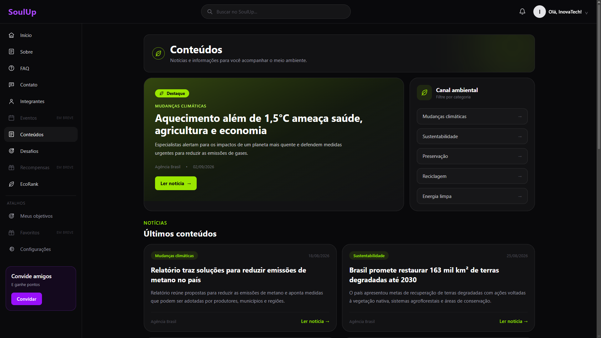
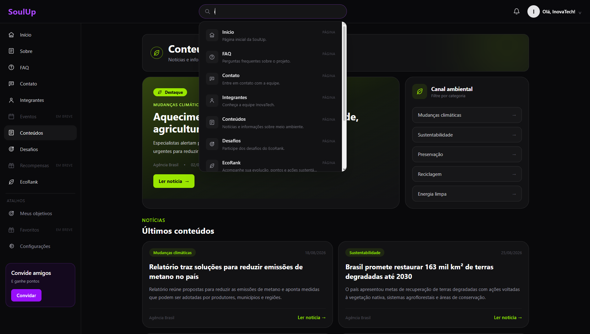
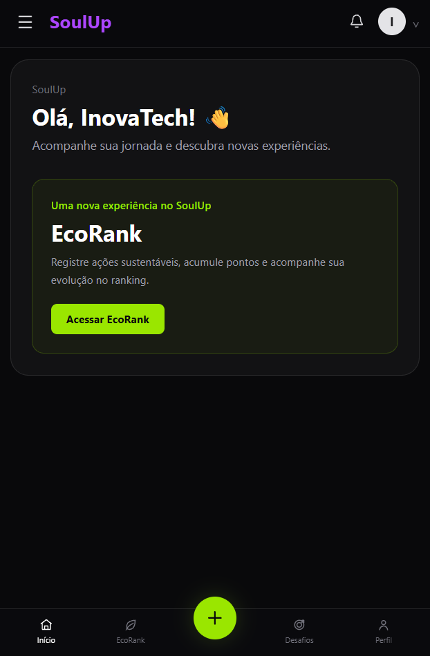

# Challenge - Front-end - FIAP

## 📌 Título e descrição do projeto

**Nome do Projeto:** EcoRank + SoulUp

**Objetivo do Projeto:**

Desenvolver o EcoRank como uma funcionalidade integrada à plataforma SoulUp, incentivando ações sustentáveis por meio de pontuação, validação das ações, evolução de níveis e ranking entre usuários.

### ⚠️ Observação

As imagens que estão **fora da pasta `public/images`** são imagens adicionadas exclusivamente neste arquivo `README.md`. Portanto, elas não fazem parte dos arquivos utilizados diretamente pelo site e, por esse motivo, estão armazenadas fora da pasta `public/images`.

---

## 💻 Tecnologias utilizadas

As seguintes tecnologias e ferramentas foram utilizadas no desenvolvimento do projeto:

1. React
2. Vite
3. TypeScript
4. Tailwind CSS
5. React Router DOM
6. React Hook Form

---

## 🌐 API utilizada no projeto

**URL:**

[https://back-end-challenge-yxlu.onrender.com](https://back-end-challenge-yxlu.onrender.com)

---

## 📂 Estrutura de pastas do projeto

Abaixo está a organização dos principais arquivos e diretórios do projeto:

```text
📁 EcoRank-SoulUp-React-Vite-TS-ADAPTADO-COMPLETO
│
├── 📄 index.html → Arquivo principal de entrada da aplicação
├── 📄 package.json → Dependências, scripts e configurações do projeto
├── 📄 package-lock.json → Controle das versões das dependências instaladas
├── 📄 postcss.config.js → Configuração do PostCSS utilizado pelo Tailwind CSS
├── 📄 vite.config.ts → Configuração do Vite
├── 📄 tsconfig.json → Configuração principal do TypeScript
├── 📄 tsconfig.app.json → Configurações do TypeScript para a aplicação
├── 📄 tsconfig.node.json → Configurações do TypeScript para arquivos executados no Node.js
├── 📄 .gitignore → Arquivos e pastas ignorados pelo Git
├── 📄 README.md → Documentação do projeto
│
├── 📁 public/
│   └── 📁 images/
│       ├── 📄 guilherme.jpeg → Foto do integrante Guilherme Joel de Camargo
│       ├── 📄 pedro-felipe.jpeg → Foto do integrante Pedro Felipe de Castro Rosa
│       ├── 📄 pedro-henrique.jpeg → Foto do integrante Pedro Henrique Cavalcante De Souza
│       ├── 📄 rafaela.jpeg → Foto da integrante Rafaela Donadio Figueiredo Tavares
│       ├── 📄 victor.jpeg → Foto do integrante Victor Ferreira Gomes
│       ├── 📄 imagem-de-contato.png → Imagem utilizada na página de contato
│       ├── 📄 ranque-do-projeto.png → Representação visual da evolução dos ranques do EcoRank
│       └── 📄 tecnologias-utilizadas.png → Representação das tecnologias utilizadas no projeto
│
└── 📁 src/
    │
    ├── 📄 App.tsx → Configuração das rotas e páginas da aplicação
    ├── 📄 main.tsx → Ponto de entrada da aplicação React
    ├── 📄 index.css → Importação e configuração base do Tailwind CSS
    │
    ├── 📁 components/
    │   ├── 📄 AccountMenu.tsx → Menu da conta do usuário
    │   ├── 📄 BottomNav.tsx → Barra de navegação inferior para dispositivos móveis
    │   ├── 📄 CategoryChart.tsx → Gráfico de ações sustentáveis por categoria
    │   ├── 📄 ChallengeCard.tsx → Card de desafios sustentáveis
    │   ├── 📄 EcoRankHeader.tsx → Cabeçalho das páginas do EcoRank
    │   ├── 📄 Header.tsx → Cabeçalho principal da plataforma
    │   ├── 📄 Icons.tsx → Componentes e ícones utilizados na aplicação
    │   ├── 📄 ImpactChart.tsx → Gráfico de evolução do impacto e pontuação
    │   ├── 📄 Layout.tsx → Estrutura principal de layout da aplicação
    │   ├── 📄 LevelCard.tsx → Card de nível/ranque do usuário
    │   ├── 📄 QuickActions.tsx → Cards de ações rápidas
    │   ├── 📄 RankingCard.tsx → Card de ranking dos usuários
    │   ├── 📄 Sidebar.tsx → Menu lateral de navegação
    │   └── 📄 StatCard.tsx → Cards de indicadores e estatísticas
    │
    ├── 📁 context/
    │   ├── 📄 AuthContext.tsx → Gerenciamento de autenticação e dados dos usuários
    │   └── 📄 ThemeContext.tsx → Gerenciamento dos temas da aplicação
    │
    ├── 📁 data/
    │   └── 📄 mock.ts → Dados utilizados para demonstração do protótipo
    │
    └── 📁 pages/
        ├── 📄 Cadastro.tsx → Página de cadastro de usuários
        ├── 📄 Challenges.tsx → Página de desafios sustentáveis
        ├── 📄 Configuracoes.tsx → Página de configurações
        ├── 📄 Contato.tsx → Página de contato
        ├── 📄 Conteudos.tsx → Página de conteúdos e artigos
        ├── 📄 EcoRankDashboard.tsx → Dashboard principal do EcoRank
        ├── 📄 FAQ.tsx → Página de perguntas frequentes
        ├── 📄 Home.tsx → Página inicial da plataforma
        ├── 📄 Impact.tsx → Página de acompanhamento do impacto sustentável
        ├── 📄 Integrantes.tsx → Página com os integrantes da equipe
        ├── 📄 Login.tsx → Página de login
        ├── 📄 MeusObjetivos.tsx → Página de objetivos sustentáveis do usuário
        ├── 📄 Perfil.tsx → Página de perfil do usuário
        ├── 📄 Ranking.tsx → Página de ranking dos usuários
        ├── 📄 Sobre.tsx → Página com informações sobre o projeto
        └── 📄 SubmitAction.tsx → Página para envio e registro de ações sustentáveis
```

---

## 👥 Autores e créditos

O projeto foi desenvolvido pelos seguintes integrantes:

### 1. Guilherme Joel de Camargo
- **RM:** 570403
- **Turma:** 1TDSPK
- **GitHub:** [guilhermejcam](https://github.com/guilhermejcam)
- **LinkedIn:** [Guilherme Camargo](https://www.linkedin.com/in/guilherme-camargo-a06410410/)

### 2. Pedro Felipe de Castro Rosa
- **RM:** 569049
- **Turma:** 1TDSPK
- **GitHub:** [Pedrin740](https://github.com/Pedrin740)
- **LinkedIn:** [Pedro Felipe de Castro Rosa](https://www.linkedin.com/in/pedro-felipe-castro-rosa/)

### 3. Pedro Henrique Cardoso Cavalcante De Souza
- **RM:** 570464
- **Turma:** 1TDSPK
- **GitHub:** [pedrostack-01](https://github.com/pedrostack-01)
- **LinkedIn:** [Pedro Souza](https://www.linkedin.com/in/pedro-souza-6282333b3/)

### 4. Rafaela Donadio Figueiredo Tavares
- **RM:** 572797
- **Turma:** 1TDSPK
- **GitHub:** [mrafahdft](https://github.com/mrafahdft)
- **LinkedIn:** [Rafaela Donadio](https://www.linkedin.com/in/rafaela-donadio-bb3740369/)

### 5. Victor Ferreira Gomes
- **RM:** 569273
- **Turma:** 1TDSPK
- **GitHub:** [Victor180422](https://github.com/Victor180422)
- **LinkedIn:** [Victor Ferreira Gomes](https://www.linkedin.com/in/victor-ferreira-gomes-63b2463b5/)

---

## 🖼️ Imagens e representação do projeto

### Dashboard principal e acesso ao EcoRank

A imagem abaixo mostra onde o usuário pode acessar o EcoRank e visualizar informações sobre suas ações sustentáveis e sua colocação no ranking. Além disso, o usuário pode registrar suas ações sustentáveis acessando a opção correspondente na página.



### Sistema de login e cadastro

A imagem abaixo demonstra o sistema de autenticação do site, no qual o usuário pode criar uma conta, realizar login ou acessar uma conta disponibilizada para testes.



### Personalização de temas

Após realizar o login, o usuário também pode escolher o tema visual do site de acordo com sua preferência: claro, intermediário ou escuro.

  

### Desafios sustentáveis

Também adicionamos desafios previamente definidos em nossa solução, além da possibilidade de criação de desafios privados pelos usuários. Essa funcionalidade foi uma das recomendações recebidas durante a mentoria da SoulUp.

 

### Conteúdos e notícias ambientais

Neste projeto, também desenvolvemos uma aba de conteúdos e notícias relacionadas ao meio ambiente, com o objetivo de inspirar os usuários a praticarem ações sustentáveis.



### Barra de pesquisa

Além das funcionalidades anteriores, o site também conta com uma barra de busca e pesquisa para facilitar a localização de conteúdos e informações pelos usuários.



### Responsividade

Utilizando recursos de responsividade, também desenvolvemos uma interface adaptada para dispositivos móveis, com uma experiência visual semelhante à de um aplicativo.



---

## 🔗 Como usar

O projeto está disponível publicamente por meio do GitHub e do Vercel.

**Repositório do GitHub:**

[https://github.com/Pedrin740/Challenge---FIAP---2-Semestre.git](https://github.com/Pedrin740/Challenge---FIAP---2-Semestre.git)

**Site hospedado no Vercel:**

[https://challenge-fiap-2-semestre.vercel.app](https://challenge-fiap-2-semestre.vercel.app)

**Vídeo de apresentação do projeto no YouTube:**

[https://youtu.be/HIHY-0vwK_0](https://youtu.be/HIHY-0vwK_0)

---

## ✉️ Contato

Para dúvidas ou informações sobre o projeto, entre em contato com os integrantes por meio dos e-mails institucionais:

1. **Guilherme Joel de Camargo:** RM570403@fiap.com.br
2. **Pedro Felipe de Castro Rosa:** RM569049@fiap.com.br
3. **Pedro Henrique Cardoso Cavalcante De Souza:** RM570464@fiap.com.br
4. **Rafaela Donadio Figueiredo Tavares:** RM572797@fiap.com.br
5. **Victor Ferreira Gomes:** RM569273@fiap.com.br